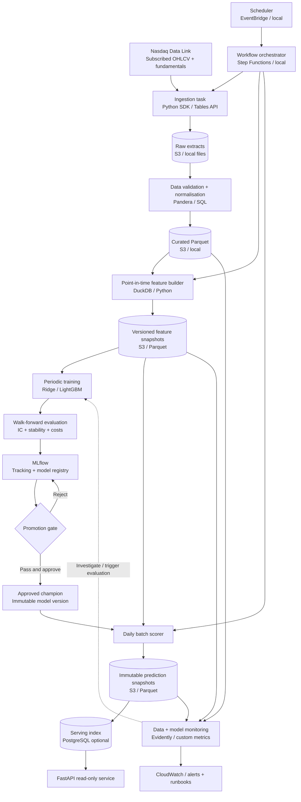
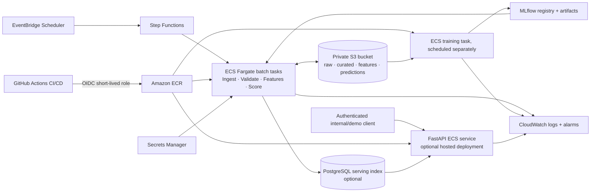

# AlphaFlow — System Architecture

**Status:** Target design, not a statement that the system has been deployed. The milestones in [README.md](README.md) track implementation.

## 1. Architecture goals

AlphaFlow is a **batch-first ML platform** that ingests subscribed Nasdaq Data Link equity data, produces information-availability-safe features, trains versioned return-ranking models, and publishes daily prediction snapshots. **Daily inference** and **periodic training** are independent workflows. The serving API reads stored predictions; it does not query Nasdaq or run model training per request.

Design priorities:

1. **Correctness:** point-in-time inputs, reproducible data and labels, controlled universe definition.
2. **Reliability:** incremental ingestion, idempotent writes, retries, validation gates, atomic publication.
3. **Reproducibility:** lineage from prediction → model artifact → experiment → data snapshot → code commit.
4. **Operability:** scheduled jobs, structured logs, quality/drift metrics, alarms, rollback.
5. **Scope:** manageable single-developer architecture without unnecessary streaming or microservices.

## 2. Logical component diagram



**Diagram note:** The serving API may read S3 directly in the local MVP. PostgreSQL becomes useful when low-latency filtering and pagination need an index. AWS services shown are target deployment components, not prerequisites for M0–M3.

## 3. Deployment diagram (target AWS stage)



**Cloud notes:** AWS IAM roles and private networking should limit access. If MLflow is self-hosted in AWS, plan its metadata backend and artifact store explicitly; the MLflow service is **not** supplied by ECR/ECS automatically. Avoid keeping a costly API, load balancer, database, or tracking server running 24/7 unless the demonstration needs one. Use a local MLflow backend first, then choose a documented persistent deployment.

## 4. Workflows and schedules

### A. Daily ingest → features → score

1. Scheduled **after the source's confirmed publication window**, not simply immediately at US close.
2. Extract incrementally with a durable watermark and correction overlap.
3. Save immutable raw payloads and run-level ingestion metadata; validate and normalise curated partitions.
4. Construct features at an explicit signal cutoff, with availability timestamps respected.
5. Load the approved **immutable model version**, create a ranked equity snapshot and validate coverage/quality.
6. Atomically publish a manifest/pointer to the latest valid snapshot; leave the previous snapshot untouched on failure.
7. Record data/model/feature/code/run lineage; emit operating metrics and alerts.

### B. Periodic challenger training → promotion

1. Freeze training data with **matured labels only** (20 trading days after the signal, plus any practical availability delay).
2. Train baselines and a challenger with walk-forward splits; prevent overlap leakage (purge/embargo where appropriate).
3. Log experiment inputs, dependencies, code commit and artifacts in MLflow.
4. Compare out-of-sample rank IC, stability, coverage, and after-cost portfolio behaviour against the champion and baseline.
5. Require predetermined gates, a smoke test, and a documented approval before changing the champion alias/reference.
6. Retain previous artifacts and release metadata to support rollback.

### C. Monitoring

- **Immediate:** API errors, data freshness, schema violations, null rates, missing securities, batch failures, duration, and output coverage.
- **Distributional:** prediction/feature drift relative to a documented reference snapshot, with safeguards for market regime changes.
- **Delayed labels:** realised cross-sectional rank IC, top-minus-bottom decile spread, and period-level performance once 20-day horizons mature.
- **Response:** alerts → investigation → optional retraining/evaluation; a drift alarm **does not automatically deploy** a new model.

## 5. Data contracts

### Storage zones

| Zone | Example path | Rules |
| --- | --- | --- |
| Raw | `raw/{dataset}/ingest_date=YYYY-MM-DD/run_id=.../` | Source payload, extraction time, request metadata; never silently overwrite |
| Curated | `curated/{dataset}/date=YYYY-MM-DD/` | Normalised and deduplicated Parquet; validation passed |
| Features | `features/version=v1/as_of_date=YYYY-MM-DD/` | Stable schema; availability-aware calculation |
| Labels | `labels/horizon=20/as_of_date=YYYY-MM-DD/` | Forward outcomes only generated after maturity; never inference input |
| Predictions | `predictions/as_of_date=YYYY-MM-DD/run_id=.../` | Immutable scores with lineage, plus a separately updated latest-valid manifest |

### Minimum run and lineage fields

`pipeline_run_id`, `started_at`, `finished_at`, `source_dataset`, `extract_timestamp`, `data_snapshot_id`, `feature_set_version`, `git_commit`, `container_digest`, `model_version`, `signal_cutoff`, `prediction_as_of_date`, `status`, and validation metrics.

### Example prediction contract (illustrative values only)

```json
{
  "security_id": "example-stable-id",
  "ticker": "EXAMPLE",
  "as_of_date": "2026-10-27",
  "signal_cutoff_utc": "2026-10-27T21:00:00Z",
  "horizon_trading_days": 20,
  "predicted_excess_return": 0.0135,
  "cross_section_rank": 42,
  "model_version": "7",
  "model_artifact_digest": "sha256:example",
  "feature_set_version": "v1",
  "data_snapshot_id": "snapshot_20261027",
  "pipeline_run_id": "score_20261027",
  "git_commit": "example-commit"
}
```

**Important:** A prediction is only actionable in the **next eligible trading session** after all its inputs were available. Do not assume a same-day closing-price trade after computing features from that close.

## 6. Point-in-time correctness and data limitations

- Daily prices must use a documented split/dividend adjustment convention. Features and target returns must be internally consistent.
- Financial statement **period end** is not its public availability date. Use report/filing/publication timestamps where available.
- A historical calculation at cutoff `t` may use only records with `available_at <= t` (with timezone and market-hours conventions defined).
- Do not let restated values replace what a model could have known historically unless the dataset supports vintage/as-reported reconstruction.
- Historical universe membership must be defined before looking at future outcomes. Consider ticker changes and delistings; report survivorship limitations if the subscription cannot reconstruct these.
- The exact Nasdaq products and API columns are **unknown until entitlements are checked**. Do not assume access to specific Sharadar tables.

## 7. ML contract and evaluation

**Task:** cross-sectional prediction of 20-trading-day forward return in excess of an explicitly defined benchmark, e.g. SPY total return. An initial LightGBM regressor produces a score; higher scores imply higher expected relative performance.

**Inputs:** lagged OHLCV-derived momentum, volatility, and liquidity features; availability-safe fundamental value, quality, and growth features; optional market regime features.

**Models:** simple rank/momentum benchmark, Ridge regression baseline, LightGBM challenger. Advanced architectures are out of scope until the system is reliable.

**Validation:** expanding or rolling chronological evaluation with purged/embargoed overlapping labels as needed; cross-sectional metrics aggregated by date; out-of-period holdouts.

**Metrics:** Spearman rank IC and stability (primary), top/bottom group spread and after-cost paper-portfolio metrics (secondary); engineering metrics kept separate. Do not optimise blindly on backtest Sharpe or claim live alpha from simulation.

## 8. API contract (read-only)

| Endpoint | Purpose | Data source |
| --- | --- | --- |
| `GET /health` | Liveness and dependency status | Service + storage checks |
| `GET /model` | Approved model version, feature version, publication time | Registry/metadata |
| `GET /predictions?as_of_date=YYYY-MM-DD` | Paginated ranking snapshot | PostgreSQL or validated snapshot files |

Do **not** expose paid raw Nasdaq records or licensed feature distributions through a public API. Authenticate any externally exposed service. Predictions should carry publication timestamps and warnings when stale.

## 9. Reliability, security, and cost controls

- **Failure isolation:** Validate into staging partitions; publish only after all checks pass; do not replace latest-good predictions on failure.
- **Idempotency:** Use stable natural keys plus run IDs, atomic output manifests, correction policy, and retry-safe upserts.
- **Secrets:** `NASDAQ_API_KEY` via local environment / AWS Secrets Manager; never in code, logs, commits, or examples.
- **Licensing:** Private raw/curated data and access-controlled artifacts; publish synthetic fixtures, code, tests, and aggregated demo outputs only when licensing permits.
- **Network/IAM:** Least privilege for each task, restricted object prefixes, role-based database access, TLS for endpoints.
- **Observability:** Structured logs with `pipeline_run_id`; CloudWatch alarms; saved evaluation, drift, and incident reports.
- **Cost:** AWS Budgets alarms, S3 lifecycle policies, scheduled rather than continuous ECS tasks, avoid always-on RDS/ALB unless justified.

## 10. Decision log

| Decision | Choice | Rationale |
| --- | --- | --- |
| Inference frequency | Daily scheduled batch | Nasdaq inputs are daily; streaming adds little value |
| Model deployment | Versioned batch scorer + read-only API | Decouples predictions from client availability |
| Feature storage | S3/Parquet + DuckDB | Cheap, reproducible and portable for single-developer scale |
| Feature store service | Not in v1 | Versioned offline snapshots are sufficient |
| ML tracking | MLflow | Traceable experiments and promotion workflow |
| Containers | Docker + ECS Fargate | Demonstrates production packaging without Kubernetes overhead |
| Orchestration | EventBridge + Step Functions in AWS | Explicit dependencies, retries, failure paths |
| Data serving index | Optional PostgreSQL | Add when necessary for query latency and pagination |
| Repo structure | Python monorepo, separate job entrypoints | Shared contracts, fewer operational surfaces |
| Retraining | Periodic and gated | Daily scoring does not imply daily retraining |

## 11. Local-to-cloud evolution

**Stage 1 — Local MVP:** Python package, mocked Nasdaq client, synthetic data fixtures, local Parquet/DuckDB, MLflow local tracking, Dockerised scorer and FastAPI, pytest/CI.

**Stage 2 — AWS batch:** S3 zones, ECR, ECS tasks, EventBridge/Step Functions, Secrets Manager, CloudWatch, OIDC-based GitHub Actions CI/CD. Host API and MLflow persistently only if useful and affordable.

**Stage 3 — Stretch:** Terraform; stronger infrastructure security; reproducible load tests; advanced model promotion policy; optional online serving index or dashboard.

## 12. Explicit non-goals

- Automated trading or brokerage order placement.
- High-frequency inference, Kafka, Kubernetes, or Spark without a demonstrated need.
- A production investment strategy or guaranteed alpha.
- Re-publication of Nasdaq subscription data.
